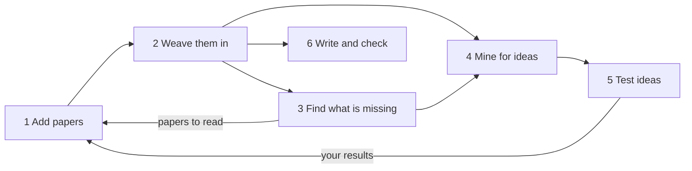

# brain-mesh

A method and tooling for building a **second brain from science papers** with Claude, as a Zettelkasten vault of interlinked markdown cards that you browse in Obsidian. The brain is meant for doing new science: proposing experiments, designing them and judging their outcomes.

This repository is the single source of truth for the method. Claude sessions load it through a small synced skill, so a change made here reaches every session.


*The concept network Claude built from three olfaction papers, shown in Obsidian's graph view. Pointing at a concept lights up every card that links to it.*

## How to use it well

You talk to Claude; Claude runs the tooling. This section says what to ask for, in what order, and what makes each step pay off. The commands are shown so you can see what happens and run them yourself when you want to.

### The loop



Papers go in, and each one is woven into what the brain already holds. The brain then shows what is missing (which sends you to more papers) and what might be true (which sends you to experiments). Your own results come back in as sources, exactly like papers. Writing draws on all of it.

| Stage | Ask Claude | Skill | Main commands |
|---|---|---|---|
| Set up, once | "Start a brain mesh vault on …" | `brain-mesh-setup` | `init`, `sync` |
| 1 Add papers | "Add this paper" (attach the PDF and its supplementary files); "Add these eight as a batch" | `brain-mesh-add-paper`, `brain-mesh-batch` | `anchor`, `refs`, `cite`, `split`, `check`, `staged`, `adopt` |
| 2 Weave them in | Done as part of adding. To go back over old papers: "Scan all sources for concepts" | `brain-mesh-add-paper`, `brain-mesh-concept-scan` | `scan`, `contradictions`, `place`, `independence`, `build` |
| 3 Find what is missing | "What are the key gaps on …? What should I read next?" | `brain-mesh-gaps` | `gaps`, `gapsdoc`, `matrix` |
| 4 Mine for ideas | "Run a discovery session on …"; "What is in reach with what I have?"; "What is missing from the brain on …? What would other fields bring?" | `brain-mesh-discover`, `brain-mesh-beyond` | `zoom`, `routes`, `profile`, `outside`, `beyond`, `discover`, `facts`, `dismiss` |
| 5 Test ideas | "Turn that into a hypothesis and design the experiment"; later "Here are my results" | `brain-mesh-experiment` | `matrix`, `impact` |
| 6 Write and check | "Write the background on … from the brain"; "Audit this draft against the brain" | `brain-mesh-write` | `table`, `draft` |
| Decide what next | "Give me a frontier map"; "Why do these results disagree?"; "Is this idea new?"; "What changed this week?" | `brain-mesh-report` | `report` |
| Keep it healthy | "Run housekeeping" | `brain-mesh-housekeeping` | `health`, `sample` |

Every session starts and ends with one command, `python3 tools/mesh.py sync` (`python` on Windows). It pulls, rebuilds, commits and pushes.

### Set up, once

- **One vault per research topic,** in its own private GitHub repository. Publisher PDFs stay out of anything shared.
- **Write the scope first,** in the Overview of `MAP.md`: what is in, what is out, what the brain is for. A stated scope is what later lets a gap be called a gap.
- **Put your standing rules in the vault's `CLAUDE.md`,** below the generated part: every agent reads it at the start of every session. Example: "generic statistics terms are low priority".
- **Browse in Obsidian.** Start at `MAP`, follow a concept hub, and open a paper's marked PDF: every card is a highlight on the page, and unhighlighted text has no card.

### 1. Add papers

- **Start with the few papers your question turns on,** one at a time, so the vocabulary settles. Then add batches of five to eight, one agent per paper. The merge sets the pace, not the reading.
- **Supply the supplementary material with the PDF.** What is missing is recorded as missing, and methods are usually there.
- **Say which papers matter.** Priority (high, normal, low) sets the depth of everything: a high paper is read panel by panel, verified by a second agent, and more of its references are recommended.
- **Decide proposed concepts quickly.** Agents propose new concepts and you adopt, fold or reject them (`staged`, `adopt`, `reject`). A shared vocabulary is what links one paper to the next, so twins left undecided cost you links.
- **Expect, for each paper:** evidence cards (one statement each, with its page), a claims card (what the paper says it showed, against what its evidence carries), a study profile (question, design, sample, framework), reference cards for what it cites, and cards for its data sets and code.

### 2. Weave them in

This step connects the new paper to everything already in the brain. It is part of adding a paper, and `check` keeps warning until it is done.

1. **Concept scan** (`scan P012`): every concept the brain holds is looked for across the paper, so facts mentioned in passing are carded too, each with the works the paper cites for it.
2. **Contradictions** (`contradictions P012`): every clash with what the brain holds is logged on the register, or dismissed with the reason. Never smooth one over: contradictions are where new theories and experiments come from.
3. **Placement** (`place P012`): each result supports or counts against a finding, and every open gap, tension, contradiction and hypothesis the paper bears on gets a recorded decision.
4. **Grading** (`independence`): findings are graded on independent groups of sources. Two papers from one group, or on one data set, count once.
5. **Hubs:** each concept card gains what the paper adds, and every relation says how far it is causal: tested, correlational, proposed or inferred.

After you adopt or hand-make a concept, run `scan <concept>` to find it in the papers already in the brain.

### 3. Find what is missing

`gaps` scans for candidates; most are not worth a card. Each one kept climbs a ladder, one rung at a time:

1. **Extraction gap:** the answer is in a paper you already hold. Re-read it for that question.
2. **Brain gap:** the literature has it, the brain does not. It goes on the reading list.
3. **Research gap:** a logged search finds nothing. Only now is it a gap to do science on.

Skipping a rung is the usual mistake: proposing an experiment that page 7 of a paper in the vault already answers. `ledger/reading-queue.md` ranks what to read next by how much each cited work bears on your gaps, tensions and high-priority cards. Read from the top, then go back to stage 1.

### 4. Mine for ideas

Discovery looks for what the brain implies and no paper states. It finds the open needs in the brain (a contradiction, a gap, an oddity, an untested assumption, a thinly supported finding, a ceiling nobody has explained), matches each to a way a paper makes a contribution, marks whether you could do it, and checks it against what lies outside the brain. Everything it shows is a prompt for you to judge, worked out afresh from the cards at every call.

**What to ask Claude**

| You want | Ask | Claude runs |
|---|---|---|
| A first session | "Interview me for my research profile, then run a discovery session" | `profile`, `zoom`, `routes` |
| Ideas on one topic | "Run a discovery session on odour intensity" | `zoom`, `routes topic:<slug>` |
| What you could start now | "What is in reach with what I have? What is one ingredient short?" | `routes --reach in` |
| One kind of contribution | "Which findings most need replicating?" "Where would a new method move most?" | `routes --route replication`, `--route new-method` |
| To know whether an idea is new | "Check V003 outside the brain" | `outside V003` |
| What the brain is missing | "What does the brain lack on receptor coding? Compare it with Wikipedia and the MeSH terms" | `beyond terms`, `beyond wiki`, `beyond probe` |
| Tools from other fields | "What would other fields bring to G004?" | `outside G004`, `beyond pointers`, `beyond judge … tool` |
| What new papers changed | "What did the last batch change?" | `discover --recheck` |
| More from discovery | "What would let discovery see more?" | `routes --readiness` |

**Before the first session.** Five things decide how good every later session is.

1. **Finish weaving the papers in.** Run discovery on a brain that is integrated, never on half-added papers.
2. **Set priority** on the few concepts, gaps and papers your work turns on. Priority is what `zoom` ranks by first.
3. **Give your research profile.** Tell Claude which of the brain's techniques, organisms and preparations you have, which you could reach through a partner and which are out; the kinds of study you run; the data you can get; what you bring from outside the field; where you could apply a finding. It takes a few minutes (`python tools/mesh.py profile` lists what to ask about, most used first) and is kept in `PROFILE.md`. Without it nothing can be ranked by what you could do. Update it when your lab changes.
4. **Read `routes --readiness`.** It lists each thing discovery reads from the cards, how much of it is coded, and which routes that limits. A low line is housekeeping that pays: conditions written as `when::` codes, methods linked to their technique, results that name the data set they use, a definition card for a much-used variable.
5. **Run `beyond terms` and `beyond pointers`.** A term the papers use and the brain has no concept for is invisible to every step below.

**A session, step by step.** One topic per session works better than a sweep of the whole brain.

1. **`zoom`** shows the topics, hottest first: your priorities, then open contradictions, tensions and gaps, then fresh signals; once you have a profile, each topic also shows how many routes are in reach. Pick your focus, or the hottest topic not explored lately.
2. **`routes topic:<slug>`** is the agenda, best first, in about 1,500 tokens. Each opportunity reads like this:

   ```
   4. resolve-contradiction: V003 [contradiction, open] The paper says ... · topic:odour-intensity
      has: measured or derived on 2 of 2 cards · conditions recorded on 1 of 1 observations · data available: D004 (open)
      missing: nothing works on it · no hypothesis or registered prediction
      not coded: not checked outside the brain (`mesh.py outside V003`)
      reach: in reach (reanalysis of D004 (open))
      next: propose a seed or hypothesis that takes it up · proof it would need: each side reproduced ...
   ```

   `has` is what the cards already show, `missing` what they show is absent, and `not coded` what they do not say either way. `reach` is the best of three ways of doing the work: from the published record alone, by reanalysing data the cards use, or by measuring again with a technique and in a system your profile has. An opportunity marked `ONE INGREDIENT SHORT` is the best prompt there is.
3. **Verify the best three to five on their cards.** The tooling read only the coded lines. Claude opens the need (`zoom <id>`), lists the facts on its concepts (`facts`), and reads the page for anything a decision will rest on.
4. **Supply the missing ingredient where that is cheap:** a lens pass over a paper already held, a definition card, a link to the data set.
5. **Check outside the brain.** `outside <need>` gives the questions, one for each ingredient the brain lacks. Claude answers first from what it knows of the field, then searches the literature, and records what came back with its date. The last question is always the cross-field one: said without this field's words, what kind of problem is this, and what do other fields use for it?
6. **Hear the proposals.** Three to seven, each naming its route, its ingredients, its reach, what the outside check found and the proof it would need. Accept, reject with the reason (`dismiss`), or leave for later. Only what you accept is written, as a seed, a hypothesis, a gap or a theory card.
7. **Record.** `zoom topic:<slug> --explored "<what was done>"` so the next session starts somewhere new, and `routes --record` so the next batch of papers can show what it moved.

**The twenty routes.** `routes --list` describes each with its ingredients; `routes --route <name>` keeps one.

| Kind of contribution | Routes | What the brain must already hold |
|---|---|---|
| Recombining what is published | `resolve-contradiction`, `unification`, `joining-literatures`, `pooling`, `framework` | independent groups, measured results, definitions that agree, conditions recorded |
| Established means, well aimed | `fill-gap`, `decisive-test`, `mechanism`, `extension`, `replication`, `scale` | a gap whose literature was searched, rival accounts, a technique that measures the variable, data you can get |
| A borrowed means | `tool-transfer`, `concept-transfer` | a technique or formalism used elsewhere in the brain, kept from outside it, or brought by you |
| Surprise | `new-phenomenon`, `overturn-assumption`, `existence-proof` | an oddity nobody explains, an assumption much rests on, a statement that something cannot be done |
| A new means | `new-method`, `new-model`, `new-resource` | a technique with recorded limits, a score no method gets past, data the field lacks |
| Outward | `translation` | a probable or established finding, and an application you named |

Seven need no new data: `unification`, `joining-literatures`, `pooling`, `framework`, `scale`, `concept-transfer` and `new-model`.

**Looking beyond the brain.** The steps above can only work on what the brain can name. `beyond` compares the brain with something outside it and sorts every name into one of four places: a concept already; in the papers' text with no concept (a hole to fill: propose a concept or add an alias); only in the titles of cited works (reading); nowhere in the brain (out of scope, a paper to find, or a tool from another field).

| Compare the brain with | Command | Needs |
|---|---|---|
| The papers' own words | `beyond terms [topic:<slug>]` | nothing |
| The papers' own pointers to other fields, and to what a question would take | `beyond pointers` | nothing |
| Wikipedia: a concept's neighbours, links between concepts the brain does not connect, the family a technique belongs to | `beyond wiki <concept or topic:<slug>> [--family]` | a network (pages are cached in the vault and sync) |
| Any list of names: Claude's own map of a topic, MeSH headings, a review's headings | `beyond probe … --frame "<where from>"` | a literature connector or web search |
| A review's reference list, related or citing articles | `beyond works … --frame "<where from>"` | the same |

Compare each topic once, when you first mine it. Claude records every verdict (`beyond judge`: skip, concept, alias, lead or tool), so nothing is raised twice, and a tool kept from another field shows up in `routes` and in `outside <need>` from then on. `python tools/mesh.py beyond` lists what has been compared and which topics never were.

**After new papers.** Nothing above is stored as a result, so it all moves when the brain does. `discover --recheck`, run at the end of every paper or batch, reports three things:

- **Your earlier ideas:** which seeds, theories and rejected signals the new evidence strengthened, weakened, dissolved or reopened.
- **The routes:** opportunities the papers brought, ingredients that arrived or went, what came into reach, since the last `routes --record`.
- **Beyond the brain:** a lead or an outside tool that a paper now names, and a term you set aside that twice as many papers now use.

Then run `beyond terms` again: a shared term appears only once two papers use it.

**It stays readable as it grows.** `zoom`, `routes`, `ask`, `find` and `facts` print to a budget. A concept hub lists its first cards by title and links a generated page (`index/hubs/`) for the rest; `build` and `check` count warnings by kind once there are more than forty and keep every line in `index/check.txt`; `gaps` and a bare `discover` print the head of each section. `--all` or `--full` prints everything. Figure and equation crops are WebP, about a fifth of the size of PNG; `crops --convert` converts the PNG crops of an older vault and rewrites their embeds.

**What makes it work**

- **Signals are prompts, not findings.** The rank orders prompts; it does not measure worth.
- **Proposals must respect the evidence** (`facts <concept>`). One may go against a card only where a logged contradiction covers that card.
- **"Not coded" is not "missing".** It means the cards do not say. Often the paper does, and a lens pass settles it.
- **Out of reach is not untrue.** Those opportunities stay on the books (`routes --reach out`) as work for a collaborator.
- **Outside knowledge is a lead.** What Claude knows, what a search finds and what Wikipedia says go onto a card only when the paper is in the brain. "Nothing found" is recorded with where and when, never as "nobody has done this".
- **A name not found is only a name not found.** Before treating something as absent, check its other names; and check that `beyond wiki` read the right article.
- **Reject with a reason** (`dismiss`). A rejected signal stays away until a new paper bears on it.
- **Record conditions as codes.** Species, preparation, method and level of organisation written as conditions can be mined across; left in the prose, they cannot.

**Single miners.** `routes` gathers the signals of all twenty-two miners under the route each feeds. Turn to one miner when you want more of one kind (`discover bridges --focus topic:<slug>`), and work them in this order, since scores do not compare across miners:

| Order | Miners | What they settle |
|---|---|---|
| 1 Check the ground | `contradictions`, `definitions`, `constraints`, `links` | Are the clashes logged? Do the sources mean the same thing by a term and measure it the same way? Do the numbers agree across papers? |
| 2 Explain disagreements | `moderators`, then a read through the open contradictions | What differs between the two sides: a condition, a method, a definition? |
| 3 Extend what holds | `transfer`, `implied`, `bridges`, `analogies` | What is established here and untried there; what follows from chaining effects; which concepts nobody has put together |
| 4 Stress the structure | `assumptions`, `oddities`, `genealogy`, `theories`, `cornerstones`, `mechanism`, `limits` | What everything rests on; what nobody has explained; which rival accounts nothing separates; what one group alone holds up; what was never tested by intervention; what is said to be impossible |
| 5 Look at the means | `tools`, `unify`, `recognised`, `bottlenecks`, `ceilings`, `data` | A technique never brought to a question; one driver behind several outcomes; gaps the field already agrees on; where a new method or model would move most; open data nobody else has used |

### 5. Test ideas

- **An accepted idea becomes a hypothesis** with its rivals and its predictions written down.
- **The best experiment** is the one whose result differs depending on which side of a contradiction, or which rival theory, is right.
- **Register the predictions and the decision rule before the data exist.**
- **Bring the results back as a source.** They are carded like a paper, judged against the registered predictions, and the findings, gaps and contradictions they touch are regraded.

### 6. Write and check

- **Evidence tables:** `table <concept or finding>` gives one row per result with the study, its design and sample, the conditions, the limits and the page.
- **Writing from the brain:** a review or a background section organised by theme, each claim traced to a card and a page, said as strongly as the evidence and no more.
- **Auditing a draft:** `draft <file>` lists what to check in your own text, sentence by sentence: numbers against the cards, causal wording against what was tested, citations the brain knows only second-hand, and claims a logged contradiction bears on. Claude then gives each claim a verdict (supported, overstated, contradicted, not in the brain) and a corrected draft. Do it before anything is submitted.

### Reports: deciding what to do next

`python3 tools/mesh.py report <kind>` assembles one dated document in `reports/`, every line linked to its cards; Claude then writes a short reading at the top. `MAP` links the latest of each kind.

| Report | The question | Run it |
|---|---|---|
| `frontier` | Where is a discovery most likely? | Before choosing what to work on, read or bid for |
| `contradictions` | Why do these results disagree, and what would settle it? | Before designing an experiment |
| `theories` | Which account is winning? | Once rival explanations exist |
| `causal` | What is known to cause what, and how do we know? | Before claiming a mechanism |
| `robustness` | What do we believe on thin evidence? | Before building on a finding, and before writing |
| `methods` | What could be done with what already exists? | When planning methods or looking for a reanalysis |
| `novelty "<idea>"` | Is this idea new? | Before proposing a study or promoting an idea |
| `changes` | What moved in the brain? | After every batch, and when coming back after time away |

A report is a snapshot: run it again when the brain changes, and never treat it as a source.

### How often

| When | What |
|---|---|
| Every session | `sync` first and last |
| Once, and when your lab changes | The research profile (`profile`) |
| Every paper or batch | Stages 1 and 2, then `discover --recheck` (your earlier ideas, the routes and the leads from outside that the papers moved) and `report changes` |
| Every five to ten papers, or monthly | `health`, `gaps`, the reading queue, `report frontier` and `report robustness`; a discovery session on the hottest topic; `beyond terms`, and that topic compared with an outside map; `routes --readiness` |
| Now and then | An audit: `sample P012 10` puts ten cards beside their source text, to check meaning rather than typing |
| Before an experiment | `report contradictions` and `report novelty` on the idea; discovery on the question; a hypothesis with rivals; registered predictions |
| Before submitting text | `draft` |
| Weekly, unattended | A scheduled check that reports and changes nothing |

### What to expect at each size

A rough guide; it depends on how closely the papers bear on one another.

| Papers | What pays off |
|---|---|
| 1 to 3 | Claims against evidence within each paper, contradictions, definitions, evidence tables, draft audits. Most gaps are reading-list gaps. From discovery: `beyond pointers`, and a first comparison with an outside map to see what the papers leave out. |
| 5 to 20 | Findings with independent support, tensions and their moderators, numbers pooled across papers, transfer, research gaps that survive a search. `routes` starts to pay: resolving contradictions, pooling, extension, replication, reanalysis of open data. `beyond terms` finds the shared vocabulary the brain has no concept for. |
| 20 and up | Bridges, chains of effects, rival theories against the findings, analogies, batches and scheduled passes. The routes that need breadth: joining literatures, unification, decisive tests, tools and concepts carried across. |

### Asking the brain

Ask Claude a question about your field and it answers from the brain with `python tools/mesh.py ask "<the question>"`. In one call, within about 2,500 tokens, that returns the brain's conclusions on the question with their grades, the hub facts, the relations with their basis, the most relevant evidence cards and what was not read in full, each line carrying a card id. Claude opens only the cards the answer needs.

To explore rather than answer, Claude uses `python tools/mesh.py zoom`. It shows the brain as a hierarchy, revealed on a need-to-know basis: the topics first (groups of concepts that appear together), ranked by your priorities, their open contradictions and gaps, and the signals the miners find in them; then one topic, one concept, one finding or contradiction, one evidence card and its page, each level in about 1,000 tokens. Discovery runs top-down: the hottest topic, the routes inside it only, a shortlist for you, and a note of the branch explored so the next session starts somewhere new.

Both keep a session's context small however large the brain grows. The commands rank and trim their output too: `find` shows the 25 most relevant hits, `show` cuts long generated lists, `table` shows the 25 most relevant rows, and each says how many more there are. Claude never reads a hub or `index/` whole, and hands wide sweeps (a full discovery pass, a scan of many papers, the audit of a long draft) to subagents that report back only their conclusions.

### Habits that pay

1. **Check the page.** Every card links to its place in the PDF. Open it whenever a value or a wording matters.
2. **Use priority to steer.** Set high the few concepts, papers and gaps your work turns on, each with a reason, and review them when your question changes. Only you set priority. The same goes for your research profile: it says what you can do, and only you say it.
3. **Count groups, not papers,** and say how far each relation is causal.
4. **Log contradictions** rather than settling them informally.
5. **Climb the gap ladder** before calling anything unknown. "Not in the brain" is not "not in the literature".
6. **Put your own results, talks and notes in as sources,** so nothing enters without provenance.
7. **Edit the prose freely in Obsidian;** leave the generated parts alone, and tell Claude afterwards so the coded lines can be brought into step.
8. **Keep one writer at a time,** and pause automatic syncing in Obsidian while a batch runs.

## What is here

| Path | What it is |
|---|---|
| `skills/brain-mesh/SKILL.md` | The map: card families, ids, grades, links, navigation, rules. Read first, by every session. |
| `skills/brain-mesh/FORMATS.md` | The card formats: every card type's sections and Codes, evidence types, link keys, citations, priority, the PDF rules. Read before writing or changing a card. |
| `skills/brain-mesh-access/SKILL.md` | Read every session, by any agent: syncing with GitHub, navigating and answering, adding your own material, editing, retiring and deleting cards. |
| `skills/brain-mesh-setup/SKILL.md` | Starting a vault, tooling, Obsidian, sharing, upgrading. |
| `skills/brain-mesh-add-paper/SKILL.md` | Adding a paper or an own result: anchor, references, extract, duplicate rules, link, verify, integrate, update the hubs. Lens passes. |
| `skills/brain-mesh-batch/SKILL.md` | Adding many papers at once: prepare, extract with one agent per paper in parallel, merge. |
| `skills/brain-mesh-concept-scan/SKILL.md` | Scanning chosen or all sources for every concept in the brain, carding each new fact with the works the paper cites for it, adding missing citations, updating the hubs. |
| `skills/brain-mesh-write/SKILL.md` | Writing from the brain (a literature review, a background section, evidence tables) with every claim traced to a card and page, and auditing a draft against the brain claim by claim. |
| `skills/brain-mesh-report/SKILL.md` | Dated reports assembled from the cards: frontier map, contradiction dossier, theory scorecard, causal map, robustness audit, methods and data landscape, novelty check, what-changed digest. |
| `skills/brain-mesh-gaps/SKILL.md` | Finding key gaps, hunting papers that fill them, the research-gaps document. |
| `skills/brain-mesh-experiment/SKILL.md` | Hypotheses, experiment design, registered predictions, assessing outcomes. |
| `skills/brain-mesh-discover/SKILL.md` | Discovery sessions with the user: topics by need to know, routes to a contribution, the research profile, checks outside the brain, the miners; theory, analogy and seed cards; rechecking them as sources arrive. |
| `skills/brain-mesh-beyond/SKILL.md` | Finding what the ontology lacks by comparing it with something outside it: the sources' own words, Wikipedia, MeSH, a review, the literature around the sources, and the tools other fields use for the same kind of problem. |
| `skills/brain-mesh-housekeeping/SKILL.md` | Health report, merges, corrections and retractions, audits, edits made in Obsidian. |
| `tools/mesh.py` | The tooling. One file, Python 3.8+, standard library plus PyMuPDF for PDFs (and, optionally, Pillow for small figure crops). `python3 tools/mesh.py help` lists the commands. |
| `loader/SKILL.md` | The small skill that is synced to Claude. It clones or pulls this repository and routes to the right document. |
| `demo-vault/` | A complete small vault built from invented papers. Open the folder in Obsidian and start at `MAP`. |
| `tests/run.sh` | Tests for the tooling. |
| `VERSION`, `CHANGELOG.md` | Version of the method and tooling. |

## The ideas in one paragraph

Every note is a card with a permanent id and a meaningful name. An evidence card holds one statement from one source, written for a person first and repeated underneath as codes that Claude and the tooling can traverse. Concept cards are the hubs you browse; they grow with every paper. Links are typed, carry a reason, and are mirrored onto both cards. Findings, tensions and gaps are built on evidence, and hypotheses and experiments on those. The source PDF is the ground truth: the original is sealed with a checksum, and a marked copy shows every card as a highlight on the page it came from. Each paper gets a claims card (its main claim and up to five sub-claims, linked to its evidence and to the findings they feed), every data set and code base a study uses gets its own card, and every work the sources cite gets a reference card with BibTeX, and the brain suggests what to read next: works cited by several of its sources, and works cited where its gaps and tensions rest. You steer its effort with a priority on any card (high, normal, low): a high card draws deeper treatment to everything one link away.

## Installing

In Claude, the synced `brain-mesh` skill does the loading. By hand:

```bash
git clone https://github.com/tcpearce/brain-mesh.git && cd brain-mesh
pip install pymupdf pillow                          # Pillow is optional: it makes figure crops WebP instead of PNG
bash tests/run.sh                                   # should end with ALL TESTS PASSED
python3 tools/mesh.py init ../my-vault "My topic brain" "One-line topic"
```

Vaults do not live in this repository. Each vault is its own folder, or its own private repository, with a `CLAUDE.md` that tells any agent working in a clone (Claude Code, say) to follow `brain-mesh-access` and sync with GitHub first and last, because it holds your papers and your unpublished thinking. Publisher PDFs and their extracted text should stay out of anything shared.

## Changing the method

1. Edit the document under `skills/`, or `tools/mesh.py`.
2. Run `bash tests/run.sh`. Add a test for anything new that the tooling enforces.
3. Raise the version in `VERSION` and in `tools/mesh.py` together, and add a line to `CHANGELOG.md`.
4. Commit and push.

Each Claude session picks the change up at its next pull. A vault picks up new tooling with `python3 tools/mesh.py upgrade <vault>` run from this repository, followed by `build` in the vault. The loader skill only needs re-saving in Claude if this repository moves or is renamed.

The documents here are followed by Claude as instructions, so keep write access to this repository to people you trust.
