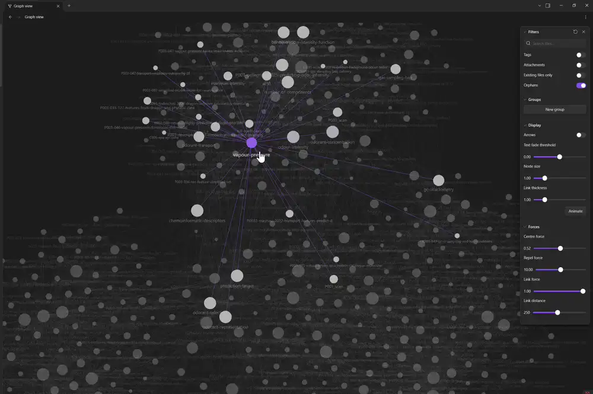
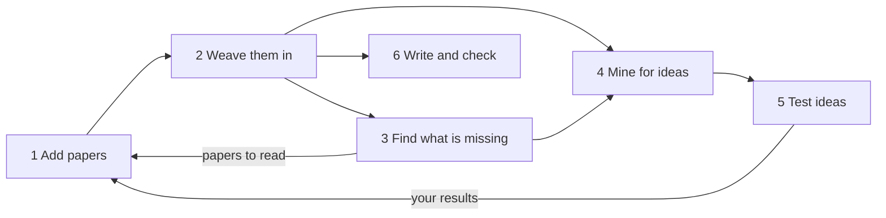

# brain-mesh

A method and tooling for building a **second brain from science papers** with Claude, as a Zettelkasten vault of interlinked markdown cards that you browse in Obsidian. The brain is meant for doing new science: proposing experiments, designing them and judging their outcomes.

This repository is the single source of truth for the method. Claude sessions load it through a small synced skill, so a change made here reaches every session.



*The concept network Claude built from three olfaction papers, shown in Obsidian's graph view. Pointing at a concept lights up every card that links to it.*

## How to use it well

You talk to Claude; Claude runs the tooling. This section says what to ask for, in what order, and what makes each step pay off. The commands are shown so you can see what happens and run them yourself when you want to.

### The loop



Papers go in, and each one is woven into what the brain already holds. The brain then shows what is missing (which sends you to more papers) and what might be true (which sends you to experiments). Your own results come back in as sources, exactly like papers. Writing draws on all of it.

| Stage | Ask Claude | Skill | Main commands |
|---|---|---|---|
| Set up, once | "Start a brain mesh vault on …" | `brain-mesh-setup` | `init`, `sync` |
| 1 Add papers | "Add this paper" (attach the PDF and its supplementary files); "Add these eight as a batch" | `brain-mesh-add-paper`, `brain-mesh-batch` | `anchor`, `refs`, `cite`, `split`, `check`, `staged`, `adopt` |
| 2 Weave them in | Done as part of adding. To go back over old papers: "Scan all sources for concepts" | `brain-mesh-add-paper`, `brain-mesh-concept-scan` | `scan`, `contradictions`, `place`, `independence`, `build` |
| 3 Find what is missing | "What are the key gaps on …? What should I read next?" | `brain-mesh-gaps` | `gaps`, `gapsdoc`, `matrix` |
| 4 Mine for ideas | "Run a discovery session on …" | `brain-mesh-discover` | `discover`, `facts`, `dismiss`, `theories` |
| 5 Test ideas | "Turn that into a hypothesis and design the experiment"; later "Here are my results" | `brain-mesh-experiment` | `matrix`, `impact` |
| 6 Write and check | "Write the background on … from the brain"; "Audit this draft against the brain" | `brain-mesh-write` | `table`, `draft` |
| Decide what next | "Give me a frontier map"; "Why do these results disagree?"; "Is this idea new?"; "What changed this week?" | `brain-mesh-report` | `report` |
| Keep it healthy | "Run housekeeping" | `brain-mesh-housekeeping` | `health`, `sample` |

Every session starts and ends with one command, `python3 tools/mesh.py sync` (`python` on Windows). It pulls, rebuilds, commits and pushes.

### Set up, once

- **One vault per research topic,** in its own private GitHub repository. Publisher PDFs stay out of anything shared.
- **Write the scope first,** in the Overview of `MAP.md`: what is in, what is out, what the brain is for. A stated scope is what later lets a gap be called a gap.
- **Put your standing rules in the vault's `CLAUDE.md`,** below the generated part: every agent reads it at the start of every session. Example: "generic statistics terms are low priority".
- **Browse in Obsidian.** Start at `MAP`, follow a concept hub, and open a paper's marked PDF: every card is a highlight on the page, and unhighlighted text has no card.

### 1. Add papers

- **Start with the few papers your question turns on,** one at a time, so the vocabulary settles. Then add batches of five to eight, one agent per paper. The merge sets the pace, not the reading.
- **Supply the supplementary material with the PDF.** What is missing is recorded as missing, and methods are usually there.
- **Say which papers matter.** Priority (high, normal, low) sets the depth of everything: a high paper is read panel by panel, verified by a second agent, and more of its references are recommended.
- **Decide proposed concepts quickly.** Agents propose new concepts and you adopt, fold or reject them (`staged`, `adopt`, `reject`). A shared vocabulary is what links one paper to the next, so twins left undecided cost you links.
- **Expect, for each paper:** evidence cards (one statement each, with its page), a claims card (what the paper says it showed, against what its evidence carries), a study profile (question, design, sample, framework), reference cards for what it cites, and cards for its data sets and code.

### 2. Weave them in

This step connects the new paper to everything already in the brain. It is part of adding a paper, and `check` keeps warning until it is done.

1. **Concept scan** (`scan P012`): every concept the brain holds is looked for across the paper, so facts mentioned in passing are carded too, each with the works the paper cites for it.
2. **Contradictions** (`contradictions P012`): every clash with what the brain holds is logged on the register, or dismissed with the reason. Never smooth one over: contradictions are where new theories and experiments come from.
3. **Placement** (`place P012`): each result supports or counts against a finding, and every open gap, tension, contradiction and hypothesis the paper bears on gets a recorded decision.
4. **Grading** (`independence`): findings are graded on independent groups of sources. Two papers from one group, or on one data set, count once.
5. **Hubs:** each concept card gains what the paper adds, and every relation says how far it is causal: tested, correlational, proposed or inferred.

After you adopt or hand-make a concept, run `scan <concept>` to find it in the papers already in the brain.

### 3. Find what is missing

`gaps` scans for candidates; most are not worth a card. Each one kept climbs a ladder, one rung at a time:

1. **Extraction gap:** the answer is in a paper you already hold. Re-read it for that question.
2. **Brain gap:** the literature has it, the brain does not. It goes on the reading list.
3. **Research gap:** a logged search finds nothing. Only now is it a gap to do science on.

Skipping a rung is the usual mistake: proposing an experiment that page 7 of a paper in the vault already answers. `ledger/reading-queue.md` ranks what to read next by how much each cited work bears on your gaps, tensions and high-priority cards. Read from the top, then go back to stage 1.

### 4. Mine for ideas

Run discovery on a brain that is integrated, never on half-added papers. After every paper or batch, `discover --recheck` says which earlier ideas the new evidence strengthened, weakened or dissolved. Hold a full session when you want new ideas, and work the miners in this order:

| Order | Miners | What they settle |
|---|---|---|
| 1 Check the ground | `contradictions`, `definitions`, `constraints`, `links` | Are the clashes logged? Do the sources mean the same thing by a term and measure it the same way? Do the numbers agree across papers? |
| 2 Explain disagreements | `moderators`, then a read through the open contradictions | What differs between the two sides: a condition, a method, a definition? |
| 3 Extend what holds | `transfer`, `implied`, `bridges`, `analogies` | What is established here and untried there; what follows from chaining effects; which concepts nobody has put together |
| 4 Stress the structure | `assumptions`, `oddities`, `genealogy`, `theories` | What everything rests on; what nobody has explained; which rival accounts nothing yet separates |

**Routes: from a need to a contribution.** `python tools/mesh.py routes` is where a session starts. It matches every open need in the brain (a contradiction, a gap, an oddity, an untested assumption, a thinly supported finding, an unexplained ceiling) to one of twenty ways a paper makes a contribution, from resolving a contradiction or unifying separate findings to borrowing a tool, replicating a cornerstone or proving something possible. For each it lists the ingredients the brain already shows, the ones missing, the ones the cards do not say, the next step and the proof that route would need. An opportunity one ingredient short is the best prompt there is. `routes --list` describes the routes.

**Your research profile.** Tell Claude what you can do: the techniques, organisms and preparations you have, those you could reach through a partner and those that are out; the kinds of study you run; what you bring from outside the field. `python tools/mesh.py profile` records it in `PROFILE.md`. Every opportunity is then marked in reach, with a partner, unclear or out of reach. Nothing is hidden for good: what is out of reach stays true and is listed as work for a collaborator.

**Outside the brain.** Before anything is proposed as new, Claude checks it against what it knows of the field and then against the literature (`python tools/mesh.py outside <need>` gives the questions, one for each ingredient the brain lacks). What comes back is recorded as a search with its date, or as a lead from Claude's own knowledge. Neither goes onto a card until the paper is in the brain.

**It moves as the brain grows.** Nothing discovery shows is stored as a result: it is computed from the sources and their coding each time. `routes --record` keeps what a session saw, and after new papers `routes --changes` (part of `discover --recheck`) says which opportunities they brought, which gained or lost an ingredient, what came into reach, and which ideas you set aside that a new paper reopens. `routes --readiness` says how much of each thing discovery reads is coded, so you can see where coding more would let it see more.

- **Signals are prompts, not findings.** Claude judges each against its cards and the page, then proposes the worthwhile ones with the case for each. Only what you accept is written.
- **Proposals must respect the evidence** (`facts <concept>`). One may go against a card only where a logged contradiction covers that card.
- **Reject with a reason** (`dismiss`). A rejected signal stays away until new evidence bears on it.
- **Work top-down** (`zoom`, then `routes topic:<slug>` for the hottest topic) rather than reading every miner's list at once.
- **Mine around a question:** `discover --focus <concept>`, with that concept set to high priority.
- **Record conditions as codes.** The miners see only what is in a card's coded lines. Species, preparation, method and level of organisation written as conditions can be mined across; left in the prose, they cannot.

### 5. Test ideas

- **An accepted idea becomes a hypothesis** with its rivals and its predictions written down.
- **The best experiment** is the one whose result differs depending on which side of a contradiction, or which rival theory, is right.
- **Register the predictions and the decision rule before the data exist.**
- **Bring the results back as a source.** They are carded like a paper, judged against the registered predictions, and the findings, gaps and contradictions they touch are regraded.

### 6. Write and check

- **Evidence tables:** `table <concept or finding>` gives one row per result with the study, its design and sample, the conditions, the limits and the page.
- **Writing from the brain:** a review or a background section organised by theme, each claim traced to a card and a page, said as strongly as the evidence and no more.
- **Auditing a draft:** `draft <file>` lists what to check in your own text, sentence by sentence: numbers against the cards, causal wording against what was tested, citations the brain knows only second-hand, and claims a logged contradiction bears on. Claude then gives each claim a verdict (supported, overstated, contradicted, not in the brain) and a corrected draft. Do it before anything is submitted.

### Reports: deciding what to do next

`python3 tools/mesh.py report <kind>` assembles one dated document in `reports/`, every line linked to its cards; Claude then writes a short reading at the top. `MAP` links the latest of each kind.

| Report | The question | Run it |
|---|---|---|
| `frontier` | Where is a discovery most likely? | Before choosing what to work on, read or bid for |
| `contradictions` | Why do these results disagree, and what would settle it? | Before designing an experiment |
| `theories` | Which account is winning? | Once rival explanations exist |
| `causal` | What is known to cause what, and how do we know? | Before claiming a mechanism |
| `robustness` | What do we believe on thin evidence? | Before building on a finding, and before writing |
| `methods` | What could be done with what already exists? | When planning methods or looking for a reanalysis |
| `novelty "<idea>"` | Is this idea new? | Before proposing a study or promoting an idea |
| `changes` | What moved in the brain? | After every batch, and when coming back after time away |

A report is a snapshot: run it again when the brain changes, and never treat it as a source.

### How often

| When | What |
|---|---|
| Every session | `sync` first and last |
| Every paper or batch | Stages 1 and 2, then `discover --recheck` and `report changes` |
| Every five to ten papers, or monthly | `health`, `gaps`, the reading queue, `report frontier` and `report robustness`, a discovery session |
| Now and then | An audit: `sample P012 10` puts ten cards beside their source text, to check meaning rather than typing |
| Before an experiment | `report contradictions` and `report novelty` on the idea; discovery on the question; a hypothesis with rivals; registered predictions |
| Before submitting text | `draft` |
| Weekly, unattended | A scheduled check that reports and changes nothing |

### What to expect at each size

A rough guide; it depends on how closely the papers bear on one another.

| Papers | What pays off |
|---|---|
| 1 to 3 | Claims against evidence within each paper, contradictions, definitions, evidence tables, draft audits. Most gaps are reading-list gaps. |
| 5 to 20 | Findings with independent support, tensions and their moderators, numbers pooled across papers, transfer, research gaps that survive a search. |
| 20 and up | Bridges, chains of effects, rival theories against the findings, analogies, batches and scheduled passes. |

### Asking the brain

Ask Claude a question about your field and it answers from the brain with `python tools/mesh.py ask "<the question>"`. In one call, within about 2,500 tokens, that returns the brain's conclusions on the question with their grades, the hub facts, the relations with their basis, the most relevant evidence cards and what was not read in full, each line carrying a card id. Claude opens only the cards the answer needs.

To explore rather than answer, Claude uses `python tools/mesh.py zoom`. It shows the brain as a hierarchy, revealed on a need-to-know basis: the topics first (groups of concepts that appear together), ranked by your priorities, their open contradictions and gaps, and the signals the miners find in them; then one topic, one concept, one finding or contradiction, one evidence card and its page, each level in about 1,000 tokens. Discovery runs top-down: the hottest topic, the miners inside it only, a shortlist for you, and a note of the branch explored so the next session starts somewhere new.

Both keep a session's context small however large the brain grows. The commands rank and trim their output too: `find` shows the 25 most relevant hits, `show` cuts long generated lists, `table` shows the 25 most relevant rows, and each says how many more there are. Claude never reads a hub or `index/` whole, and hands wide sweeps (a full discovery pass, a scan of many papers, the audit of a long draft) to subagents that report back only their conclusions.

### Habits that pay

1. **Check the page.** Every card links to its place in the PDF. Open it whenever a value or a wording matters.
2. **Use priority to steer.** Set high the few concepts, papers and gaps your work turns on, each with a reason, and review them when your question changes. Only you set priority.
3. **Count groups, not papers,** and say how far each relation is causal.
4. **Log contradictions** rather than settling them informally.
5. **Climb the gap ladder** before calling anything unknown. "Not in the brain" is not "not in the literature".
6. **Put your own results, talks and notes in as sources,** so nothing enters without provenance.
7. **Edit the prose freely in Obsidian;** leave the generated parts alone, and tell Claude afterwards so the coded lines can be brought into step.
8. **Keep one writer at a time,** and pause automatic syncing in Obsidian while a batch runs.

## What is here

| Path | What it is |
|---|---|
| `skills/brain-mesh/SKILL.md` | The map: card families, ids, grades, links, navigation, rules. Read first, by every session. |
| `skills/brain-mesh/FORMATS.md` | The card formats: every card type's sections and Codes, evidence types, link keys, citations, priority, the PDF rules. Read before writing or changing a card. |
| `skills/brain-mesh-access/SKILL.md` | Read every session, by any agent: syncing with GitHub, navigating and answering, adding your own material, editing, retiring and deleting cards. |
| `skills/brain-mesh-setup/SKILL.md` | Starting a vault, tooling, Obsidian, sharing, upgrading. |
| `skills/brain-mesh-add-paper/SKILL.md` | Adding a paper or an own result: anchor, references, extract, duplicate rules, link, verify, integrate, update the hubs. Lens passes. |
| `skills/brain-mesh-batch/SKILL.md` | Adding many papers at once: prepare, extract with one agent per paper in parallel, merge. |
| `skills/brain-mesh-concept-scan/SKILL.md` | Scanning chosen or all sources for every concept in the brain, carding each new fact with the works the paper cites for it, adding missing citations, updating the hubs. |
| `skills/brain-mesh-write/SKILL.md` | Writing from the brain (a literature review, a background section, evidence tables) with every claim traced to a card and page, and auditing a draft against the brain claim by claim. |
| `skills/brain-mesh-report/SKILL.md` | Dated reports assembled from the cards: frontier map, contradiction dossier, theory scorecard, causal map, robustness audit, methods and data landscape, novelty check, what-changed digest. |
| `skills/brain-mesh-gaps/SKILL.md` | Finding key gaps, hunting papers that fill them, the research-gaps document. |
| `skills/brain-mesh-experiment/SKILL.md` | Hypotheses, experiment design, registered predictions, assessing outcomes. |
| `skills/brain-mesh-discover/SKILL.md` | Mining the brain with the user for new hypotheses and links; theory, analogy and seed cards; rechecking them as sources arrive. |
| `skills/brain-mesh-housekeeping/SKILL.md` | Health report, merges, corrections and retractions, audits, edits made in Obsidian. |
| `tools/mesh.py` | The tooling. One file, Python 3.8+, standard library plus PyMuPDF for PDFs. `python3 tools/mesh.py help` lists the commands. |
| `loader/SKILL.md` | The small skill that is synced to Claude. It clones or pulls this repository and routes to the right document. |
| `demo-vault/` | A complete small vault built from invented papers. Open the folder in Obsidian and start at `MAP`. |
| `tests/run.sh` | Tests for the tooling. |
| `VERSION`, `CHANGELOG.md` | Version of the method and tooling. |

## The ideas in one paragraph

Every note is a card with a permanent id and a meaningful name. An evidence card holds one statement from one source, written for a person first and repeated underneath as codes that Claude and the tooling can traverse. Concept cards are the hubs you browse; they grow with every paper. Links are typed, carry a reason, and are mirrored onto both cards. Findings, tensions and gaps are built on evidence, and hypotheses and experiments on those. The source PDF is the ground truth: the original is sealed with a checksum, and a marked copy shows every card as a highlight on the page it came from. Each paper gets a claims card (its main claim and up to five sub-claims, linked to its evidence and to the findings they feed), every data set and code base a study uses gets its own card, and every work the sources cite gets a reference card with BibTeX, and the brain suggests what to read next: works cited by several of its sources, and works cited where its gaps and tensions rest. You steer its effort with a priority on any card (high, normal, low): a high card draws deeper treatment to everything one link away.

## Installing

In Claude, the synced `brain-mesh` skill does the loading. By hand:

```bash
git clone https://github.com/tcpearce/brain-mesh.git && cd brain-mesh
pip install pymupdf
bash tests/run.sh                                   # should end with ALL TESTS PASSED
python3 tools/mesh.py init ../my-vault "My topic brain" "One-line topic"
```

Vaults do not live in this repository. Each vault is its own folder, or its own private repository, with a `CLAUDE.md` that tells any agent working in a clone (Claude Code, say) to follow `brain-mesh-access` and sync with GitHub first and last, because it holds your papers and your unpublished thinking. Publisher PDFs and their extracted text should stay out of anything shared.

## Changing the method

1. Edit the document under `skills/`, or `tools/mesh.py`.
2. Run `bash tests/run.sh`. Add a test for anything new that the tooling enforces.
3. Raise the version in `VERSION` and in `tools/mesh.py` together, and add a line to `CHANGELOG.md`.
4. Commit and push.

Each Claude session picks the change up at its next pull. A vault picks up new tooling with `python3 tools/mesh.py upgrade <vault>` run from this repository, followed by `build` in the vault. The loader skill only needs re-saving in Claude if this repository moves or is renamed.

The documents here are followed by Claude as instructions, so keep write access to this repository to people you trust.
